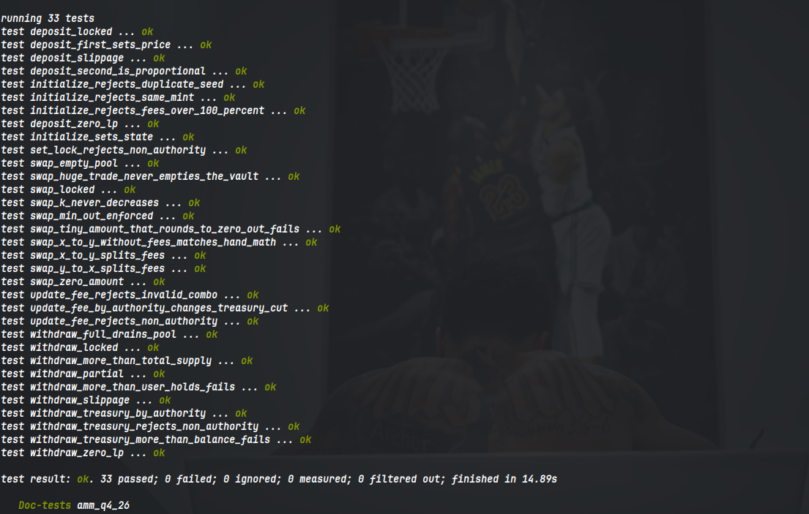

# AMM: a constant-product market maker on Solana

A small automated market maker (AMM) built with [Anchor](https://www.anchor-lang.com/). It lets anyone swap between two SPL tokens against a shared liquidity pool, and rewards the people who fund that pool with trading fees. The swap math is written from scratch with no curve library, and every instruction is covered by LiteSVM tests.

Program_ID: CwTqtnyRARLtWNXNY6NaBYJDdntLEY9iHp52ikyteHca



## Features

- **Constant-product pricing.** The pool keeps `x · y = k`, so the price moves automatically as people trade.
- **Liquidity provision.** Depositors receive LP tokens that represent their share of the pool and can redeem them at any time.
- **Two-part fees.** Each swap pays an **LP fee**, which stays in the pool, and a **protocol fee**, which goes to a treasury.
- **Treasury controlled by a PDA.** Collected fees sit in token accounts owned by a program-derived address. Only the pool authority can withdraw them, through the program.
- **Slippage protection.** Deposit, withdraw and swap all take limits (`max_*` or `min_*`), so a trade fails instead of executing at a worse price.
- **Pause switch.** The authority can lock the pool.
- **Overflow-safe math.** All arithmetic uses `u128` intermediates and checked operations.

## How it works

### The invariant

The pool holds reserves `x` (token X) and `y` (token Y). A swap must leave their product unchanged or larger:

```
(x + dx) · (y − dy) = x · y        →        dy = y · dx / (x + dx)
```

For a pool of 1,000,000 X and 1,000,000 Y, paying in 10,000 X returns `1,000,000 × 10,000 / 1,010,000 = 9,900.99`, which rounds down to **9,900** Y. The shortfall against a 1:1 price is the _price impact_. It grows with trade size, and no trade can empty the reserve.

### Fees

Each swap goes through three steps in order:

1. **Protocol cut.** `amount_in × protocol_fee / 10,000` is sent to the treasury.
2. **LP fee.** `fee` (in basis points) is taken from the remainder. It stays in the vault but is **not** fed into the curve, so `k` grows after every swap. That growth is how LPs earn.
3. **Curve.** The remaining amount is run through the formula above to get the output.

Worked example, with `fee` = 30 bps, `protocol_fee` = 20 bps, and 10,000 X paid in:

| Step                       | Amount                                  |
| -------------------------- | --------------------------------------- |
| Protocol cut (to treasury) | 20                                      |
| Net into vault             | 9,980                                   |
| LP fee (stays in vault)    | 29                                      |
| Fed to the curve           | 9,951                                   |
| Output to user             | `1,000,000 × 9,951 / 1,009,951` = 9,852 |

(1 bps = 0.01%, so 30 bps = 0.30%.)

### Rounding

Rounding always favours the pool, so repeated tiny operations can't drain it:

| Operation                 | Rounds |
| ------------------------- | ------ |
| Swap output               | down   |
| Deposit amounts owed      | up     |
| Withdraw amounts returned | down   |

## Accounts

All pool accounts are program-derived addresses (PDAs), so only the program can sign for them.

| Account                    | Seeds                  | Role                                                                                                        |
| -------------------------- | ---------------------- | ----------------------------------------------------------------------------------------------------------- |
| `config`                   | `["config", seed]`     | Pool settings: mints, fees, authority, lock flag, bumps. Also owns the vaults and is the LP mint authority. |
| `mint_lp`                  | `["lp", config]`       | LP token mint (6 decimals).                                                                                 |
| `vault_x`, `vault_y`       | ATAs of `config`       | Pool reserves.                                                                                              |
| `treasury`                 | `["treasury", config]` | Data-less PDA that owns the treasury token accounts.                                                        |
| `treasury_x`, `treasury_y` | ATAs of `treasury`     | Collected protocol fees.                                                                                    |

`seed` (a `u64`) lets one program host many pools.

## Instructions

| Instruction         | Arguments                  | Who                        | What it does                                                                                                      |
| ------------------- | -------------------------- | -------------------------- | ----------------------------------------------------------------------------------------------------------------- |
| `initialize`        | `seed, fee, protocol_fee`  | anyone (becomes authority) | Creates the config, LP mint, vaults and treasury. Requires `fee + protocol_fee ≤ 10,000` and two different mints. |
| `deposit`           | `lp_amount, max_x, max_y`  | any user                   | Adds liquidity and mints LP. The first deposit sets the price. Later deposits must match the pool ratio.          |
| `withdraw`          | `lp_amount, min_x, min_y`  | LP holder                  | Burns LP and returns a proportional share of both tokens.                                                         |
| `swap`              | `is_x, amount_in, min_out` | any user                   | Swaps X for Y (`is_x = true`) or Y for X. Applies both fees.                                                      |
| `update_fee`        | `fee, protocol_fee`        | authority                  | Changes both fee rates.                                                                                           |
| `set_lock`          | `locked`                   | authority                  | Pauses or resumes deposit, withdraw and swap.                                                                     |
| `withdraw_treasury` | `amount_x, amount_y`       | authority                  | Sends collected fees to the authority.                                                                            |

Custom errors (`AmmError`): `InvalidFee`, `SameMint`, `PoolLocked`, `ZeroAmount`, `SlippageExceeded`, `Overflow`, `EmptyPool`, `Unauthorized`.

## Project layout

```
programs/amm_q4_26/
├── Cargo.toml
├── src/
│   ├── lib.rs                      program entrypoint
│   ├── error.rs                    AmmError
│   ├── curve.rs                    standalone constant-product math + unit tests
│   ├── state/
│   │   └── config.rs               Config account
│   └── instructions/
│       ├── initialize.rs
│       ├── deposit.rs
│       ├── withdraw.rs
│       ├── swap.rs
│       ├── update_fee.rs
│       ├── set_lock.rs
│       └── withdraw_treasury.rs
└── tests/
    └── amm.rs                      LiteSVM integration tests
```

## Getting started

**Prerequisites:** Rust, the Solana CLI, and Anchor (the project builds against Anchor 0.31).

```bash
# build the program (creates target/deploy/amm_q4_26.so)
anchor build

# run the tests
cargo test -p amm_q4_26
```

The tests load the compiled `.so`, so run `anchor build` first. They run in-process with [LiteSVM](https://github.com/LiteSVM/litesvm), so no local validator is needed. (`anchor test` starts a validator and runs the script in `Anchor.toml`. It is not required for these tests.)

## Tests

The suite has **33 tests**, listed here by instruction.

| Area         | What is checked                                                                                                                                                                                                |
| ------------ | -------------------------------------------------------------------------------------------------------------------------------------------------------------------------------------------------------------- |
| `initialize` | State is stored correctly; LP mint authority is the config PDA; same mint, fees over 100% and duplicate seeds are rejected.                                                                                    |
| `deposit`    | First deposit sets the price; later deposits are proportional; slippage, zero amount and locked pool fail.                                                                                                     |
| `withdraw`   | Partial and full withdrawals; slippage; zero amount; more than total supply; more than the user holds; locked pool.                                                                                            |
| `swap`       | X→Y and Y→X; exact fee split against an independent calculation; a hand-checked no-fee case; `min_out`; `k` never decreases; zero amount; output rounding to zero; empty pool; locked pool; very large trades. |
| admin        | `update_fee` and `set_lock` reject non-authorities; invalid fee combinations are rejected; `withdraw_treasury` works for the authority, rejects others, and fails when over-withdrawing.                       |

Expected values in the swap tests come from a separate `quote()` helper that repeats the formula in the test file, so the tests do not simply echo the program's own code.

## Reliability: mitigating downtime

Downtime in a DeFi app comes from several places: the chain (congestion or halts), RPC providers, the frontend and its hosting, the indexer behind charts and history, off-chain bots, oracles, and bad program upgrades. The guiding rule is to protect users' access to their funds first, keep trading available second, and keep the interface pleasant third.

### What this program already does

- **Permissionless core.** Swapping, depositing and withdrawing need no approval from the team, so the pool keeps working if the team disappears.
- **No oracle dependency.** Prices come from the pool's own reserves, which removes a common failure point.
- **Slippage limits on every trade.** `min_out`, `max_*` and `min_*` make a delayed transaction fail instead of executing at a stale price.
- **Pause switch.** The authority can pause the pool with `set_lock` if something goes wrong.

### What a production deployment should add

**On-chain**

- Keep withdrawals open while the pool is paused, so a pause can never trap funds. (Today `set_lock` blocks `withdraw` too.)
- Add a deadline parameter so a delayed transaction cannot execute long after it was signed.
- Put the authority and the upgrade authority behind a multisig, and add a timelock on fee changes.
- Deploy upgrades through a buffer account, test on devnet first, and keep the previous binary ready for rollback.

**Infrastructure**

- Use several RPC providers with automatic failover and health checks.
- Retry failed transactions with a fresh blockhash (blockhashes expire after roughly a minute or two), and raise priority fees dynamically during congestion.
- Host the frontend in more than one place (or on IPFS), publish the source, and provide a CLI or SDK so users can reach the program directly when the website is down.
- Make the indexer rebuildable from on-chain data, so a crash loses no information.

**Monitoring and response**

- Alert on unexpected vault balance drops, a shrinking `k`, spikes in failed transactions and RPC error rates.
- Use circuit breakers that pause swaps when the price moves implausibly within one block.
- Keep a runbook that says who can pause the pool, how, and what to tell users. Clear status updates make downtime far easier for users to accept.

### Trade-offs

A pause button protects users but is a centralisation risk. Limit it to a multisig, publish who holds it, and keep exits open. Redundancy costs money and adds complexity, so match it to the value at risk.

## Design notes and limitations

- **First depositor sets the price.** Fine for a learning project. A production AMM would mint `sqrt(x · y)` LP tokens and permanently lock a minimum amount to resist price manipulation. `curve.rs` already includes `initial_lp` for that.
- **Pause blocks exits.** `set_lock` currently stops `withdraw` as well as `swap` and `deposit`. A production protocol would normally keep withdrawals open during a pause so a pause can never trap funds.
- **Small trades can pay no protocol fee.** The cut is rounded down, so tiny swaps may round it to zero.
- **No deadline parameter.** Slippage limits protect the price but not against a transaction being delayed. A deadline would add that.
- **Single authority key.** Use a multisig for the authority in any real deployment.
- **Standard SPL Token only.** Token-2022 mints (and their extensions) are not supported.
- **Unaudited.** This is educational code, not production software.
